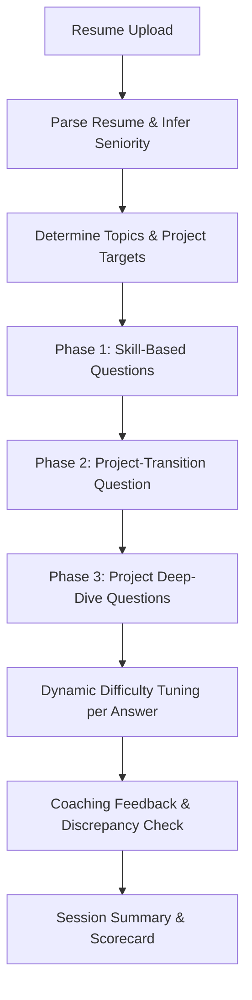

# GroundedHire: Intelligent RAG-Driven Technical Interview Platform

GroundedHire is an end-to-end, RAG-grounded technical interview preparation and candidate evaluation platform. It dynamically generates technically sound, personalized interview questions by matching textbook concepts (extracted and indexed via FAISS) with a candidate's parsed resume details. The system evaluates candidate responses in real-time, adjusts question difficulty adaptively, flags discrepancies between candidate answers and their resume descriptions, and aggregates session results into a comprehensive technical scorecard.

---

## 🌟 Key Features

1. **ATS Resume Parsing & Skill Extraction**
   - Automatically parses resume sections (experience, education, projects, skills).
   - Employs an LLM to infer the candidate's seniority level and set the starting difficulty tier.
   
2. **Grounded RAG Retrieval**
   - Segments reference textbooks into contextual chunks.
   - Builds high-dimensional dense vector search indexes using FAISS for lightning-fast, relevant search.

3. **Dynamic Question Personalization & Adaptive Difficulty**
   - Tailors textbook questions to match the candidate's skills and projects.
   - Adjusts difficulty levels dynamically (`beginner` $\longleftrightarrow$ `intermediate` $\longleftrightarrow$ `intermediate-dense`) depending on the candidate's performance.

4. **Coaching-Oriented Real-Time Evaluation**
   - Generates constructive, coaching-oriented feedback rather than punitive pass/fail marks.
   - **Resume Discrepancy Detection**: Inspects answers to project-related questions and flags any metrics, frameworks, or details that contradict or are missing from the provided Resume Project Description.

5. **Resilient LLM Strategy**
   - Utilizes high-performance Groq API (`llama-3.3-70b-versatile`) for prompt, high-quality reasoning.
   - Gracefully falls back to local Ollama (`mistral:7b-instruct` or similar) in the event of API rate limits or network issues.

---

## ⚙️ Technical Deep-Dive & Mechanisms

### 1. Role Selection & Textbook Mapping
When initializing an interview, the candidate selects their target role:
- **`ai_ml_engineer`**: Targets advanced machine learning pipelines, neural networks, and optimization.
- **`data_science_applied_ml`**: Focuses on data processing, statistical modelling, and feature engineering.

Textbook PDFs are placed in respective subdirectories under `role_pdfs/` (e.g. `role_pdfs/ai_ml_engineer/`).
- **Ingestion Filtering**: During ingestion (`ingest.py`), blank pages, cover sheets, table of contents (using dot leader heuristics), author pages, bibliographies, references, and appendices are automatically parsed out to ensure retrieval is grounded only in core concepts.
- **Chunking Pipeline**: Text is grouped page-by-page. Hard boundaries are set at section headings. Paragraphs are greedily packed into chunks of **~500 tokens** (hard-split at **900 tokens**). Inside each section, a sliding window of **~15% overlap (~75 tokens)** is maintained between consecutive chunks to prevent information loss at chunk edges.
- **Ingestion-Time Difficulty Tagging**: Chunks are labeled with difficulty tiers based on the source textbook's filename:
  - `beginner`: for introductory texts (filename containing `"absolute"` or `"beginners"`).
  - `intermediate-dense`: for advanced texts (filename containing `"burkov"`, `"brownlee"`, or `"hundred"`).
  - `intermediate`: for standard textbooks.

### 2. Resume Parsing & Taxonomy Skill Mapping
- **Section Extraction**: Extracted resume text is segmented into key blocks (Skills, Projects, Experience, etc.) via heading-matching regex rules.
- **Programmatic Skill Matching**: A predefined taxonomy of **103 tools, languages, and frameworks** (e.g., PyTorch, scikit-learn, LangChain) is run against the text using case-insensitive regex boundaries.
- **Trigger-Based Topic Tagging**: Rather than basic keyword matches, the parsed resume is evaluated against a **Trigger Taxonomy Regex Keyword Map** matching 16 downstream ML topics:
  - *Example*: `decision_trees` matches occurrences of `decision tree`, `random forest`, `xgboost`, `gradient boosting`, `information gain`, etc.
  - The matched topics populate the session's technical evaluation plan (`mapped_topics`).
- **Seniority Inference**: The LLM evaluates the project and experience sections of the resume to infer the starting difficulty level (`beginner`, `intermediate`, or `advanced` mapped to `intermediate-dense`) and logs a one-sentence justification.

### 3. FAISS Vector Retrieval & Embedding Model
- **Embedding Model**: Text chunks are embedded using **`BAAI/bge-small-en-v1.5`** via the `sentence-transformers` library, which yields normalized dense vector representations optimized for cosine similarity. If the BGE model fails to load, it falls back to the standard **`all-MiniLM-L6-v2`** model.
- **Query Biasing**: To align questions with the candidate's background, the search query is dynamically biased. The system scans the candidate's skills and project descriptions for a predefined taxonomy of core machine learning keywords (e.g. `'random forest'`, `'gradient descent'`, `'neural network'`, `'svm'`). The first matched keyword that is not already in the search query is appended to it, biasing similarity retrieval toward textbook chunks containing candidate-relevant technical concepts.

### 4. Session-Length Planning & Question Selection
- **Dynamic Question Count Planning**: At the start of a session, the backend plans the interview question sequence. The session length is determined dynamically based on the candidate's background:
  - **Skill Topics**: Parsed skills are mapped to taxonomy topics, capped at a maximum of **6 skill topics**.
  - **Project Targets**: Projects in the candidate's resume that map to machine learning topics are analyzed, capped at a maximum of **3 project targets**.
  - **Dynamic Padding**: If the combined count of skill topics and project targets is less than 6, general machine learning topics (e.g., classification, deep learning, overfitting) are appended to pad the plan.
  - **Session Length**: Calculated as: `len(skill_topics) + (1 if project_targets else 0) + len(project_targets)`, clamped to a range of **6 to 10 questions**.
- **First Question Selection**:
  1. A session is started with the candidate's target role, starting difficulty, and parsed resume profile.
  2. When requesting the first question, the first topic in `skill_topics` is selected.
  3. The system queries the FAISS index for the selected role with the query string mapped to that topic (biased by the candidate's matching resume keywords) and filters for the starting difficulty tier.
  4. The highest-ranked unique textbook chunk is retrieved, and the LLM formulates a personalized question based on the retrieved text and candidate profile.

### 5. Transition and Deep-Dive Phasing
- **Phase 1: Skills Assessment**: Generates questions based on the reference topics mapped from the candidate's core skills.
- **Phase 2: Project Transition**: Connects textbook theory with the candidate's actual projects. The LLM poses a question comparing standard textbook techniques against the implementation choices described in the candidate's projects.
- **Phase 3: Project Deep-Dive**: Directs questions targeting specific metrics, frameworks, and details from the candidate's project descriptions.

---

## 🔄 Core Interview Lifecycle



---

## 🛡️ Edge Case Handling & Resilience

### 1. Resume Upload
| Edge Case | Backend Behavior | Frontend Behavior | Result |
| :--- | :--- | :--- | :--- |
| **Corrupted/non-PDF file renamed to .pdf** | Caught via `fitz.FileDataError`, returns clean `HTTPException(400)` with error message. | Displays error details in the red alert banner on the home screen. | **Safe**: No crash or blank screen. |
| **Scanned image-only PDF (no extractable text)** | Length-threshold check (`<50` chars) raises `HTTPException(400)` with descriptive message. | Displays error details in the red alert banner on the home screen. | **Safe**: Fails cleanly. |
| **Resume with no \"Projects\" section** | Falls back to empty projects list, defaults seniority inference to `"intermediate"`, generates a plan of 6 skills-only questions, and skips project phases entirely. | Interview runs smoothly through the skills phase directly to the summary view. | **Safe**: No crashes. |
| **Empty/near-empty file** | Same `<50` char threshold check triggers clean `HTTPException(400)`. | Displays error details in the red alert banner. | **Safe**: Fails cleanly. |
| **No file selected on submit** | Blocked client-side before any API call is made. | Displays user-facing warning: *"Please select or upload a resume file."* | **Safe**: Blocked on client. |

### 2. Interview Flow
| Edge Case | Backend Behavior | Frontend Behavior | Result |
| :--- | :--- | :--- | :--- |
| **Empty answer submission** | Blocked client-side before any API call is made. | Displays user-facing warning: *"Please type your answer before submitting."* | **Safe**: Blocked on client. |
| **Very long multi-paragraph answer** | Stores answer text in an unbounded SQLite `Text` database column. | Renders response text via flexible, auto-height layout containers. | **Safe**: No layout breakage. |
| **Browser refresh mid-interview** | Session state persists in the database. | SPA state resets, returning the user to the upload screen. | **Safe**: Resets cleanly. |
| **Browser back button** | Session state persists in the database. | Standard SPA behavior, exits the page/website to browser history. | **Safe**: Exits normally. |

### 3. Backend & Network
| Edge Case | Backend Behavior | Frontend Behavior | Result |
| :--- | :--- | :--- | :--- |
| **Groq API key missing/disabled** | Automatically falls back to local Ollama (`mistral:7b-instruct`) with no user-visible error. | Execution proceeds uninterrupted (minor latency increase depending on local hardware). | **Safe**: Seamless fallback. |
| **Request with non-existent `session_id`** | Performs database check and returns a clean `HTTPException(404, "Session not found")`. | Displays parsed error message instead of loading a blank question view. | **Safe**: No stack trace. |
| **Requesting question beyond `total_planned_questions`** | Backend returns `{"interview_complete": true}`. | Automatically triggers summary generator and transitions view to summary screen. | **Safe**: No loop or crash. |

#### Known Limitations by Design
- **No session resume after browser refresh**: GroundedHire is architected as a lightweight, no-login, single-session tool for local deployment; a refreshed session must be restarted from the resume upload.
- **Seniority inference scope**: Seniority estimation draws primarily from parsed Projects and Experience text blocks; resumes with experience described outside these sections may default to a conservative `"intermediate"` estimate to prevent underclassification.

---

## 📂 Project Directory Structure

```
├── backend/                  # FastAPI Web Server & Database Models
│   ├── database.py           # SQLAlchemy setup and SQLite session engine
│   ├── main.py               # API Router, endpoints, and session orchestrator
│   ├── models.py             # DB Schemas (Sessions, Questions, Answers)
│   └── schemas.py            # Pydantic payloads for request validation
├── chunks/                   # Extracted textbook text chunks (grouped by role)
├── core/                     # Modularized core computational engines
│   ├── answer_validator.py   # Compares answers against textbook/resume
│   ├── config.py             # Central path & folder setup (relatives to root)
│   ├── llm_client.py         # Resilient LLM wrapper (Groq with local Ollama fallback)
│   ├── question_generator.py # Formulates personalized & difficulty-appropriate questions
│   ├── resume_parser.py      # Extracts resume text, parses sections, and tags skills
│   └── retriever.py          # Similarity search interface with FAISS indexes
├── faiss_indices/            # High-dimensional FAISS index databases
├── frontend/                 # Vite + React Frontend Dashboard
│   ├── src/
│   │   ├── App.jsx           # Main interview dashboard and glassmorphic layout
│   │   ├── App.css           # Styling rules for layout, cards, and dark theme
│   │   ├── index.css         # Reset styles & Google Font bindings
│   │   └── main.jsx          # React entrypoint hook
│   ├── package.json          # Node dependencies
│   └── vite.config.js        # Vite bundling parameters
├── metadata/                 # Parallel metadata files associated with FAISS IDs
├── role_pdfs/                # [Gitignored] User-provided textbook PDFs
├── tests/                    # Computational verification scripts
│   ├── test_answer_validator.py  # Evaluates validation consistency (Cases A, B, C)
│   ├── test_copy_detector.py      # Verifies verbatim copying constraints
│   ├── test_personalization_fix.py# Validates personalized question framing
│   ├── test_question_generation.py# Validates textbook-to-question generation
│   ├── test_resume_parser.py      # Tests resume section splitter reliability
│   └── test_retrieval.py          # Assesses vector similarity search accuracy
├── build_index.py            # Generates embeddings and builds FAISS indices
├── grounded_hire.db          # Local SQLite Database (git-ignored)
├── ingest.py                 # OCR/PDF chunking parser
├── requirements.txt          # Python package requirements
└── view_db.py                # Console tool for querying session database logs
```

---

## 💻 Frontend Interface

The frontend is a modern, single-page application built on **Vite + React** with custom **Vanilla CSS** delivering a premium glassmorphic dark UI.

*   **Setup / Profile Panel**: Candidate enters their name, selects their target role, and uploads their resume.
*   **Active Interview Screen**:
    *   Displays the active question text, current difficulty tier, and interview phase tracker.
    *   **Interactive Spinners & Loading States**: Buttons are dynamically disabled and show loading states ("Preparing Interview...", "Retrieving next question...") to prevent multi-click errors during LLM generation.
*   **Feedback Panel**:
    *   Shows the real-time coaching feedback and discrepancy warning tags if a mismatch is detected.
    *   Hides obsolete "expected/missed points" layouts to offer a clean feedback log.
*   **Summary Screen**: Displays a final performance dashboard including total questions, quality distribution, and overall impression.

---

## 🛠️ Technology Stack & LLMs

-   **Backend**: Python, FastAPI, SQLAlchemy, SQLite (for database storage), FAISS (for vector similarity search), SentenceTransformers (for embedding generation).
-   **Frontend**: Node.js, Vite, React, Vanilla CSS.
-   **Primary LLM**: **Groq API** (`llama-3.3-70b-versatile`)
    -   *Why*: Ultra-low latency response times and state-of-the-art technical reasoning.
-   **Backup LLM**: **Local Ollama** (`mistral:7b-instruct` or `llama3`)
    -   *Why*: Resilient fail-safes ensuring uninterrupted local offline executions when hit by Groq rate limits.

---

## 🚀 Installation & Running Instructions

### 1. Set Up Environment Variables
Create a `.env` file in the workspace root:
```env
groq_api_key=gsk_your_active_groq_key_here
```

### 2. Install Dependencies
```bash
# Install Python packages
pip install -r requirements.txt

# Install Node modules
cd frontend
npm install
cd ..
```

### 3. Place Textbooks
Place reference PDF textbooks under `role_pdfs/ai_ml_engineer/` and `role_pdfs/data_science_applied_ml/`.

### 4. Initialize Data & Build Vector Index
```bash
# Chunk the textbooks
python ingest.py

# Embed chunks and build FAISS index files
python build_index.py
```

### 5. Run Backend & Frontend Servers
In separate terminal windows, launch:
```bash
# Start FastAPI backend (Port 8000)
python -m uvicorn backend.main:app --reload --port 8000

# Start Vite React frontend
cd frontend
npm run dev
```
Open `http://localhost:5173/` in your browser.

### 6. Inspect Session Database Logs (CLI Utility)
You can view the detailed SQLite logs of all interview sessions and evaluations directly in your terminal using:
```bash
python view_db.py
```
This utility will display active sessions and output question-and-answer details including difficulty tiers and evaluation feedback.
